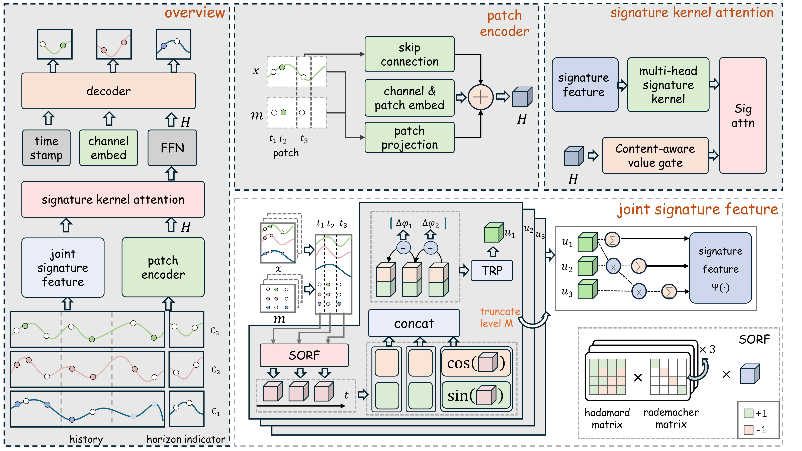

<div align="center">

# Rubato: Signature Attention for Irregular Multivariate Time Series Forecasting

**NeurIPS 2026 · Spotlight**


<a href="LICENSE"></a>

Official PyTorch implementation of **Rubato**.

[Overview](#overview) · [Quickstart](#quickstart)

**[Download datasets & checkpoints](https://drive.google.com/file/d/1RQfpyT15q_4uT3pF_ez-kVN6M6kxN4Gt/view?usp=sharing)** · **[Explore the model](models/Rubato.py)**

</div>

---

## Overview

Rubato forecasts irregular multivariate time series by combining **per-channel patch representations** with **joint signature features**. Signature attention learns relationships between patches from the multivariate trajectory, while a decoder uses target timestamps and channel embeddings to produce forecasts.

<p align="center">
  <a href="assets/rubato-architecture.pdf">
    
  </a>
</p>

- **Channel-specific content.** Lightweight MLP tokenizers encode each variable's patches, with empty patches compacted before attention.
- **Shared signature attention.** Joint random Fourier signature features define a multivariate attention kernel, paired with per-channel value gates and channel mixing.
- **Experiments ready to reproduce.** Six datasets, five runs per dataset, saved configurations, checkpoints, and evaluation metrics.

## Quickstart

### 1. Set up the environment

Use **Python 3.12+**, **PyTorch 2.10**, and an **NVIDIA GPU with a CUDA toolkit** for the bundled `fast-hadamard-transform` extension. Dependencies are declared in [pyproject.toml](pyproject.toml) and resolved in [uv.lock](uv.lock).

From the repository root, with [uv](https://docs.astral.sh/uv/) installed:

```bash
uv sync
source .venv/bin/activate
```

Keep this environment active when running the commands below. The bundled Hadamard extension includes the SORF kernels used by Rubato.

### 2. Prepare datasets and checkpoints

Download **[rubato_assets.zip](https://drive.google.com/file/d/1RQfpyT15q_4uT3pF_ez-kVN6M6kxN4Gt/view?usp=sharing)** and extract it into the repository root:

```bash
unzip rubato_assets.zip -d .
```

The archive contains the four public datasets **USHCN, FNSPID, EPA_AIR, and ClusterTrace**, together with the saved checkpoints. Data and experiment artifacts live under:

```text
storage/
├── datasets/
│   ├── USHCN/ushcn_standard.csv
│   ├── FNSPID/FNSPID_standard.csv
│   ├── EPA_AIR/EPA-Air_standard.csv
│   └── ClusterTrace/ClusterTrace_standard.csv
└── results/<dataset>/<dataset_id>/Rubato/<model_id>/...
```

**MIMIC and P12 are prepared separately.** MIMIC requires credentialed access; [P12 / PhysioNet Challenge 2012](https://physionet.org/content/challenge-2012/1.0.0/) is publicly available.

<details>
<summary><strong>Prepare MIMIC and P12</strong></summary>

The preprocessing scripts additionally require `pandas`; P12 also requires a `torchvision` version compatible with the installed PyTorch. These are not included in the base dependency list.

**MIMIC.** After obtaining access, place the prepared `full_dataset.csv` at `storage/datasets/MIMIC/raw/full_dataset.csv`. The [preprocessor](data/preprocessing/mimic.py) expects `record_id`, `Time`, and paired `Value.*` / `Mask.*` fields.

```bash
python -m data.preprocessing.mimic --root storage/datasets/MIMIC
mv storage/datasets/MIMIC/raw/mimic_standard.csv storage/datasets/MIMIC/
```

**P12.** The [preprocessor](data/preprocessing/physionet.py) downloads and processes sets A, B, and C automatically.

```bash
python -m data.preprocessing.physionet --root storage/datasets/P12
mv storage/datasets/P12/raw/physionet_standard.csv storage/datasets/P12/
```

</details>

### 3. Evaluate the saved checkpoints

Once all six datasets are available, run:

```bash
bash scripts/reproduce_main_table.sh
```

The script evaluates **six datasets × five saved training runs** (training seeds **2022–2026**). It loads the latest matching training directory for each experiment; use the downloaded result directories to evaluate the released checkpoints. New metrics are written to:

```text
storage/results/<dataset>/<dataset_id>/Rubato/<model_id>/<seq_len>_<pred_len>/<run>/iter*/eval_*/metric.json
```

### 4. Train a model

Dataset-specific configurations are provided in [scripts/Rubato](scripts/Rubato). For example:

```bash
# Train and evaluate on USHCN
bash scripts/Rubato/USHCN.sh

# Train and evaluate on FNSPID
bash scripts/Rubato/FNSPID.sh
```

Scripts are also available for [MIMIC](scripts/Rubato/MIMIC.sh), [P12](scripts/Rubato/P12.sh), [EPA_AIR](scripts/Rubato/EPA_AIR.sh), and [ClusterTrace](scripts/Rubato/ClusterTrace.sh). Model-specific options use the `--rubato_` prefix; see [utils/configs.py](utils/configs.py) for all arguments.

## Acknowledgements

Our experiment framework builds on [PyOmniTS](https://github.com/Ladbaby/PyOmniTS). The bundled CUDA implementation extends [fast-hadamard-transform](https://github.com/Dao-AILab/fast-hadamard-transform). We thank their authors for sharing these tools.

## License

This repository is released under the [MIT License](LICENSE). Datasets remain subject to their original terms of use.

## Citation

If you find this work useful, please cite our paper:

```bibtex
@inproceedings{yang2026rubato,
  title={Rubato: Signature Attention for Irregular Multivariate Time Series Forecasting},
  author={Jintao Yang and Meng Wang and Chenjuan Guo and Bin Yang},
  booktitle={NeurIPS},
  year={2026}
}
```
